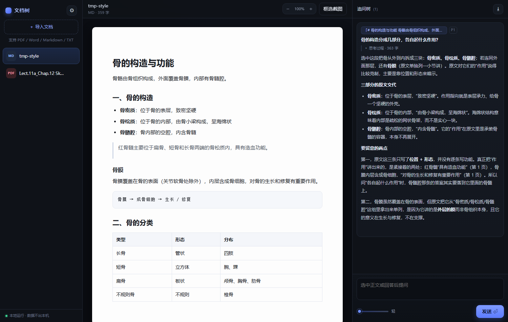

# 文档树 · DocTree

本地文档阅读器：导入 PDF / Word / Markdown / 纯文本，边读边划词提问，**每个回答都是树上的一个节点**，可以在回答里继续划词、继续分叉。

- 前端：原生 JS + PDF.js（无框架、无构建步骤）
- 后端：Node 原生 http；`server.mjs` 只做路由，业务在 `lib/`
- 桌面壳：Electron（`desktop/main.cjs`）
- 模型：任意 OpenAI 兼容端点；默认 `deepseek-flash`（V4.1-Flash，原生多模态，截图提问直接可用）
- 数据：全部存在本机 `data/`
- 版本：**UI v155 / APP 1.0.45**（变更见 [docs/v153-upgrade.md](docs/v153-upgrade.md) 与 [docs/v154-regression-fixes.md](docs/v154-regression-fixes.md)）



## 桌面版

已打包成独立应用，不需要装 Node、也没有浏览器地址栏：

```
release\DocTree-win32-x64\DocTree.exe
```

- 桌面快捷方式：**文档树**（指向 exe）、**文档树(兼容模式)**（`--disable-gpu`，显卡驱动异常时用）
- 数据目录：`%APPDATA%\文档树`（首次启动会把包内 `data` 搬过去），服务日志在同目录 `server.log`
- 内置本地服务随机端口，只监听 127.0.0.1；关闭窗口即退出
- 端口/数据目录都是独立的，可以和网页版同时开

网页版仍可用（`start.bat`），两者互不影响。

## 快速开始

1. 双击 **`start.bat`**（自动起服务并用独立窗口打开），或双击桌面上的「文档树」快捷方式
2. 点左上角「⚙」填 Base URL、API Key、模型名（默认 `deepseek-flash`）
3. 左下「＋ 导入文档」，或把文件拖进窗口
4. 在正文里**选中文字** → 浮出「用这段提问」→ 引用挂到输入框
5. 想写问题就写，不想写直接点右下角**发送**（留空用默认问法）
6. 在**回答里**再选中 → 「追问这段」，同样点发送才发，新节点挂在刚才那条下面

关闭用 `stop.bat`（只杀本目录的 4317 端口进程）。

命令行方式：

```bash
npm start          # 起服务，浏览器开 http://127.0.0.1:4317
```

## 它到底「树」在哪

每个节点长这样：

```json
{
  "id": "…",
  "parentId": "上一条的 id（顶层为 null）",
  "anchor": {
    "kind": "doc | answer | image",
    "page": 3,
    "quote": "你选中的原文",
    "rects": [{ "x": 0.1, "y": 0.2, "w": 0.3, "h": 0.02 }]
  },
  "question": "你的问题",
  "answer": "模型的回答"
}
```

`parentId` 连成树，`anchor` 记住「这段话从哪来」。提问时送给模型的上下文是：

```
文档摘要（导入时后台生成）
+ 选中处前后各 1200 字
+ 跨页检索出的 3 段相关原文
+ 这条追问的祖先链（每层压缩成 引用 + 问题 + 500 字回答）
+ 本次问题（截图时为图片）
```

所以追问不用每次塞全文，也不会跑题。

## 界面

| 区域 | 作用 |
|---|---|
| 左侧 | 文档库，可多份并存，每份一棵独立的树；**可收起**（左上角 «，或 Ctrl+B），收起后阅读区自动重排 |
| 边界 | 左右两条边界都能**拖动调宽**（悬停变蓝、双击复位），宽度记在本地；拖完 PDF 自动重排 |
| 中间 | PDF 按页原版式渲染（文字层可选中）；MD / TXT / Word 重排阅读；**← / →** 上一页 / 下一页（同 Edge 习惯，输入框里和选中文字时不触发） |
| 右侧 | 追问树，缩进 + 折叠；节点上可「追问 / 复制 / 删除」；右上 **⌗** 打开**结构图**（滚轮缩放、拖动平移、点节点定位） |
| 右上 | 缩放、页码框、旋转、荧光笔/擦除、搜索；**框选截图**（框完先挂到输入框，点发送才发） |
| 快捷键 | ← / → 翻页（瞬切）；↑ / ↓ 滚动、PgUp / PgDn 翻屏、Home / End 到首尾；Ctrl+B 收起左栏 |
| 顶部 ⭳ | 把整棵树导出成 Markdown 大纲 |

## 配置

设置面板写的是 `data/config.json`：

```json
{
  "baseUrl": "https://api.deepseek.com/v1",
  "apiKey": "sk-…",
  "model": "deepseek-flash",
  "visionModel": "deepseek-flash",
  "effort": "high"
}
```

- **思考强度**：输入框左下角的滑块，三档 `轻 / 标准 / 深度`（对应 `low / high / max`），改动即写回 `effort`。
- 长文档上下文下 3 轮中位数：轻 **2.6s** / 标准 5.3s / 深度 4.9s（首字），思考量 338 / 650 / 1438 字。短问答下三档首字差异在 1s 内，基本只有思考量差别——所以这个滑块真正的语义是「想得多细」，不是「跑得多快」。
- 这两个参数是照 DeepSeek 官方端点的格式发的：`thinking: {type:"enabled"}` + `reasoning_effort`（与 DSH 里 `pi-ai` 的 deepseek 分支一致）；非 deepseek.com 的端点不会带这两个字段，避免第三方兼容层报错。

- `deepseek-flash` 本身能读图，`visionModel` 可留空（留空即用对话模型）；换成分离式厂商时才需要单独填。
- `deepseek-flash` 会先流 `reasoning_content` 再流正文，界面显示「思考中… N 字」，回答卡片里可展开看完整思考过程。首字延迟通常 5–10 秒，属正常。
- 截图走 OpenAI 兼容的 `image_url` + `detail: high`，图以 base64 data URL 内联发送；上游单图上限 32 MiB。
- **默认不生成应试辅助内容**：不会自己加「记忆抓手 / 口诀 / 背诵表 / 考点速记 / 失分点」，只解释这段文字本身。你明确要，它才给。
- **不复述文档结构**：摘要和相关页只用于让解释准确，不会输出「在全文里的位置 / 与前后页的呼应」这类小节。
- 想完全离线：`baseUrl` 填 `http://127.0.0.1:11434/v1`，`apiKey` 随便填，`model` 填本地模型名。
- **key 以明文存在本地**，别把这个目录传到公开仓库（`.gitignore` 已排除 `data/`）。

## 目录结构

```
server.mjs             HTTP 入口：静态资源 + 路由分发 + 统一错误处理
lib/ids.mjs            id 白名单校验（所有来自请求体的 id 先过这里）
lib/http/              router / body / respond / guard（边界层：CSRF、Range、SSE）
lib/routes/            state / docs / groups / ask —— 每个文件一组端点
lib/services/ask.mjs   提问与续写共用管线（SSE、超时、工具、页图、用量）
lib/store.mjs          原子写 + schema + 损坏隔离（坏文件自动备份 .corrupt-*）
lib/llm.mjs            OpenAI 兼容 / Anthropic 端点、流式解析、重试
lib/context.mjs        摘要、检索、祖先链、导出 Markdown、系统提示词
lib/extract.mjs        PDF（含中文 cmap）/ docx / pptx / 文本解析
lib/render.mjs         页面栅格化（PDF 句柄复用）
lib/office.mjs         PPT → PDF
lib/websearch.mjs      DeepSeek Search / Fetch
public/index.html      页面结构
public/app.js          前端主逻辑（UI / 视图 / 事件）
public/modules/        util / markdown / api / sse / focus —— 前端公共模块
public/vendor/         pdfjs、marked、katex、cmaps（离线可用）
desktop/main.cjs       Electron 主进程（窗口、菜单、端口、焦点桥、CSP）
mobile/                手机端：浏览器版后端替身（api.js）、Android 壳、PWA
scripts/               测试与开发脚本（test-api / test-ui / test-electron / mock-llm）
data/docs/*.json       文档元信息 + 分页文本
data/trees/*.json      追问树
data/files/*           原始文件
```

## 测试

```bash
npm test          # = test-api（81 项）+ test-ui（31 项），自带假模型与临时数据目录
node scripts/test-electron.mjs   # 真实 Electron 验收（需要先把应用以 --remote-debugging-port 启动）
```

- `npm run test:api` 覆盖全部端点、CSRF、路径穿越、Range、空 body、损坏数据、提问/续写
- `npm run test:ui` 用本机 Chrome 跑真实页面：渲染、提问、搜索、外链、自增高、点后回焦
- `npm run bump 1.0.44 v154` 一条命令更新版本号与缓存号
- `npm run mobile` 重新生成 `mobile/www`（会一并拷 `public/modules`）

## 已知限制

- **扫描版 PDF**（纯图片）没有文字层，划词选不中 → 用右上「框选截图」。
- PDF 文字层按 PDF.js 的字符定位生成，个别排版（竖排、艺术字）选区会略有偏移。
- 系统休眠或长时间切后台后，浏览器可能回收画布内容；切回来会自动重绘（也有 20 秒兜底巡检）。
- 树是单文档的，暂不支持跨文档引用。
- 没有 TTS 朗读、没有协作、没有移动端适配。

## 开发与自测

```bash
npm run mock                    # 本地假模型（4318），不用 key 就能跑通链路
node scripts/e2e.mjs <docId>    # 端到端：划词→讲解→回答里追问→校验树
```

## 后续

- M2：目录/缩略图、快捷键、树内搜索、节点重新生成
- M3：Tauri 打包成安装包（现在是本地网页 + 独立窗口）
