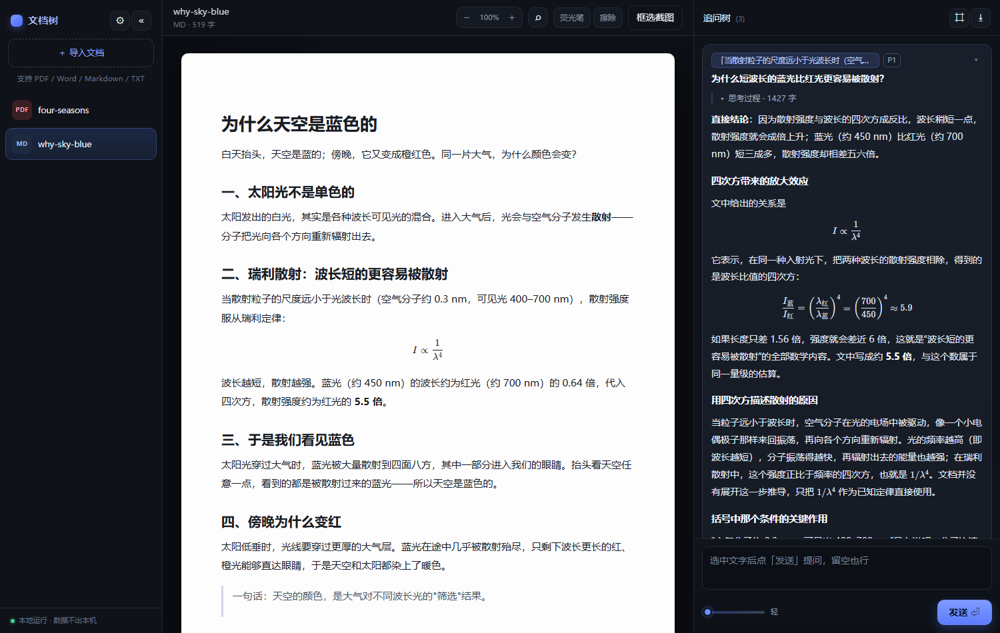
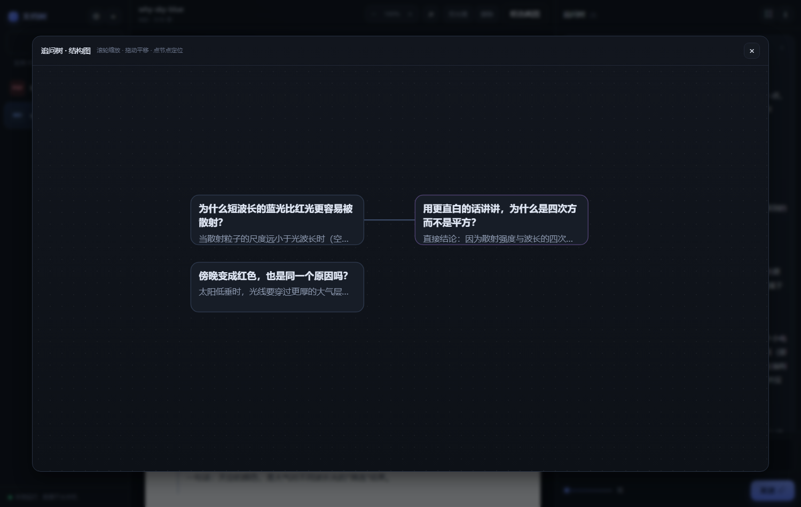
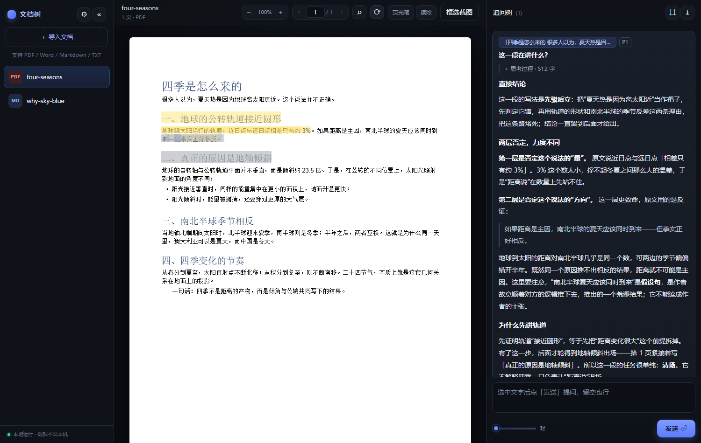

# 文档树 · DocTree

**选中就问，问过还在。**

上课听不懂的那一句、论文卡住的那一段——选中它，点「用这段提问」，回车。
不用截图、不用复制粘贴、不用切屏，连问题都可以不打。

答案贴在那行字旁边；在回答里继续选中还能追问。
每个问题都记着自己锚在原文第几页、哪一句，长成一棵树，而不是一条滚不到头的聊天记录。
下次翻回这一页，问过的都还在。

支持 PDF / Word / Markdown / 纯文本。

- 前端：原生 JS + PDF.js，无框架、无构建步骤
- 后端：Node 原生 http，单文件服务
- 模型：任意 OpenAI 兼容端点（DeepSeek / OpenAI / Ollama / 自建）
- 数据：全部留在本机 `data/`，不上传任何第三方（除了你自己配置的模型端点）



| 追问树结构图 | PDF + 荧光笔 |
|---|---|
|  |  |

详细用法见 [使用手册](docs/使用手册.md)。

## 下载

- **Windows 便携版**：[Releases](https://github.com/Aluminium0926/doc-tree/releases/latest) 下载 `DocTree-1.0.2-win32-x64.zip`，解压后双击 **`start-doctree.vbs`**（中文路径也能用）
- 或从源码运行：`npm install && npm start`

## 功能

| 能力 | 说明 |
|---|---|
| 文档阅读 | PDF 按页原版式渲染，文字层可选中；Word / Markdown / 纯文本重排阅读 |
| 划词提问 | 选中即挂引用，写不写问题都行，点「发送」才发 |
| 追问树 | 可以在回答里继续选中 → 追问，节点锚定原文或上一段回答；可折叠、可导出、可看结构图 |
| 截图提问 | PDF 上框选一块区域，把图发给多模态模型（同样先挂引用、点发送才发） |
| 荧光笔 | 三色高亮，本地保存；擦除模式点一下删除 |
| 检索 | Ctrl+F 文档内搜索，命中计数 + 位置标记 |
| 阅读控制 | 页码跳转、← → 瞬切翻页、↑ ↓ / PgUp / PgDn / Home / End 滚动、旋转 |
| 公式 | KaTeX 渲染 `$...$` 与 `$$...$$`，兼容 `\(...\)` / `\[...\]` |
| 输出 | 流式回答、思考过程可展开、思考强度三档、整棵树导出 Markdown |

## 快速开始

```bash
npm install
npm start
```

浏览器打开 http://127.0.0.1:4317 ，点右上角 **⚙** 填：

- Base URL（例如 `https://api.deepseek.com/v1`）
- API Key
- 模型名（例如 `deepseek-flash`）

也可以直接编辑 `data/config.json`（参考 `data/config.example.json`）。

不想花额度、只想试交互：`npm run mock` 会起一个假模型端点（4318），把 Base URL 指过去即可。

## 快捷键

| 键 | 作用 |
|---|---|
| ← / → | 上一页 / 下一页（PDF，瞬切） |
| ↑ / ↓ | 滚动 90px |
| PgUp / PgDn | 翻一屏 |
| Home / End | 到首尾 |
| Ctrl+F | 文档内搜索 |
| Ctrl+B | 收起/展开左栏 |
| Esc | 关闭浮层、退出荧光笔/擦除、关搜索 |

## 数据

```
data/config.json     模型配置（含明文 key，注意别提交）
data/docs/*.json     文档元信息 + 分页文本 + 摘要 + 高亮
data/trees/*.json    追问树（问题、回答、引用锚点）
data/files/*         原始文件
```

备份就是复制 `data/` 目录。删除界面里的文档会连带删除其追问树和原文件。

## 桌面版

```bash
npm install
npm run app     # 开发模式直接开窗口
npm run dist    # 用 electron-packager 打包到 release/
```

打包后是一个便携目录（`DocTree-win32-x64`），双击 `start-doctree.vbs` 启动。数据目录会切到 `%APPDATA%\文档树`，首次启动自动从包内 `data/` 复制。

> **中文路径**：直接双击 `DocTree.exe` 时，Electron 在某些含非 ASCII 字符的路径下会启动即崩（`0x80000003`）。`start-doctree.vbs` 会检测路径，必要时把程序复制到 `%LOCALAPPDATA%\Programs\DocTree` 再从那里启动，所以解压位置随意。

## 目录结构

```
server.mjs            HTTP 服务：静态资源、导入、SSE 转发、持久化
lib/extract.mjs       PDF（含中文 cmap）/ docx / 文本解析
lib/store.mjs         data/ 读写
lib/llm.mjs           OpenAI 兼容端点、流式解析、思考强度
lib/context.mjs       摘要、检索、祖先链、导出；系统提示词也在这里
public/               前端（index.html / app.js / style.css）
public/vendor/        pdfjs、marked、katex、cmaps（离线可用）
desktop/main.cjs      Electron 主进程
scripts/              冒烟测试、假模型、导入测试
```

## 自定义

- 回答风格、是否生成应试内容：改 `lib/context.mjs` 里的 system prompt
- 默认端口：环境变量 `PORT`（默认 4317）
- 数据目录：环境变量 `DOCTREE_DATA`

## 已知限制

- 扫描版 PDF 没有文字层，划词选不中 → 用「框选截图」
- 旋转视图下高亮暂不显示（坐标会错位）
- 一棵树只属于一个文档，暂不支持跨文档引用
- 没有 TTS 朗读、协作、移动端适配
- 首字延迟取决于模型；思考强度「轻」最快

## 许可

MIT
