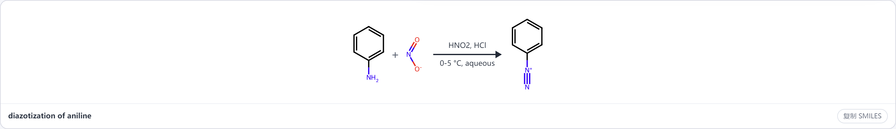

# v155 · 化学式两张报错截图的根因与修复

> 版本：**UI v155 / APP 1.0.45**
> 现象来源：用户截图（2026-11-25 10:45）
> 1. 反应式三个组分全部显示「SMILES 无法解析」，箭头上下的试剂/条件被切掉
> 2. 同一个块过一会儿变成「结构渲染超时，请刷新后重试」+ 原始 SMILES

---

## 一、根因（一条链路串起两张图）

### 1. CSP 把 RDKit 拦死了（v153 我引入的回归）

v153 给 Electron 加了 CSP：

```
script-src 'self' 'wasm-unsafe-eval'
```

RDKit 的 emscripten 胶水层初始化时必须 `eval` 一段 JS，控制台报：

```
Refused to evaluate a string as JavaScript because 'unsafe-eval' is not an allowed
source of script in the following Content Security Policy directive:
"script-src 'self' 'wasm-unsafe-eval'"
```

于是 `initRDKitModule()` 直接抛错 → `moleculeSvg()` 对每个组分都失败 → 三个组分全部显示「SMILES 无法解析」。
（网页版没有 CSP，所以只有桌面版这样。）

**修复**：CSP 的 `script-src` 增加 `'unsafe-eval'`。渲染层已有 `sandbox: true`、脚本只允许 `'self'`、
模型输出过 `sanitizeHtml`，这个代价可以接受；不加就没有化学式。

### 2. `partial` 不被看门狗当终态（v147 就有）

`enhanceChemBlocks` 给每个卡片挂了 15 秒看门狗，条件是：

```js
if (fig.dataset.state === 'done' || fig.dataset.state === 'error') return
```

但「部分组分画不出来」时 `drawReaction` 设置的是 `'partial'` —— 既不是 done 也不是 error，
于是 15 秒后看门狗把**已经画好的部分结果**覆盖成「结构渲染超时」。这就是第二张图的来历。

**修复**：卡片一开始就置 `state='rendering'`；看门狗只对 `'rendering'` 生效；
`draw()` 结束/异常时置终态并 `clearTimeout`。partial 现在是正式终态。

### 3. 试剂/条件被裁掉

`.chem-agents` / `.chem-cond-arrow` 原来是 `position: absolute` + `bottom/top: calc(50% ± 6px)`，
**不参与行高计算**；`.chem-figure` 又是 `overflow: hidden`，
所以两行条件一旦超过分子高度就被切掉（截图 1 里 "HNO2," 和 "aqueous" 各被切一半）。

**修复**：箭头列改成 flex 纵向流：

```
试剂
─────▶   ← 箭头线
条件
```

标签参与布局、把整行撑高，`overflow:hidden` 不再裁到它们；条件最大宽度 130 → 150px。

### 顺手做的

- 引擎没起来时不再逐个显示「SMILES 无法解析」，而是整块提示「化学引擎未能加载：<原因>」，避免误判成模型写错
- 单个组分失败的徽标 `title` 里带上真实错误（原来只有 SMILES 文本）

---

## 二、验证

| 用例 | 结果 |
|---|---|
| `test-ui` §4.5：真 RDKit 渲染用户那个反应式（3 个 `.chem-part svg`、0 个错误徽标） | ✅ |
| `test-ui` §4.5：试剂/条件文本完整，且矩形落在画布内（不裁剪） | ✅ |
| `test-ui` §4.5：`CCO.NOT_A_SMILES>>CC` 停在 `partial`，等 15.5 秒后**不会**被改成「渲染超时」 | ✅ |
| `test-electron`：CSP 下 `initRDKitModule` 能初始化并解析 `Nc1ccccc1` | ✅ |
| `test-electron`：控制台无 eval 相关 CSP 拦截 | ✅ |
| 安装版实测（CDP 注入同一反应式）：`state=done`、3 个组分、0 错误、`HNO2, HCl` / `0-5 °C, aqueous` 完整 | ✅ |

修复后的实际渲染（`docs/chem-fix-v155.png`）：



---

## 三、改动文件

- `desktop/main.cjs`：CSP `script-src` 加 `'unsafe-eval'`
- `public/chem.js`：渲染状态机（rendering/done/partial/error）、看门狗只对 rendering、引擎失败单独提示、徽标 title
- `public/style.css`：`.chem-rxn-arrow` 改 flex 流式布局，去掉绝对定位与 calc
- `scripts/test-ui.mjs`：+7 条化学用例（总计 52 项）
- `scripts/test-electron.mjs`：+2 条（RDKit 在 CSP 下可用）
