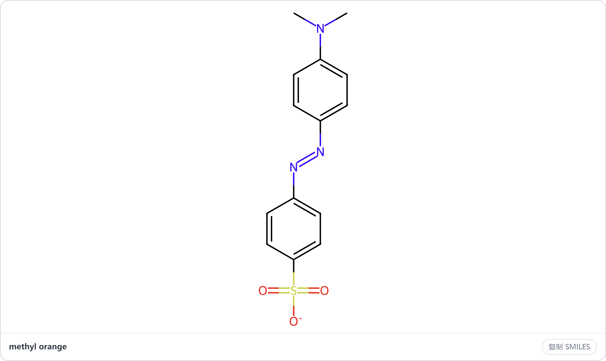
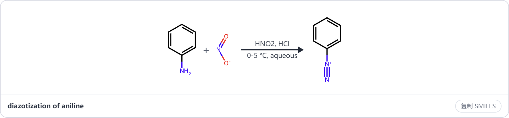

# v156 · 化学块语义与箭头中线

> 版本：**UI v156 / APP 1.0.46**
> 来源：用户截图（甲基橙）——「左右两边一样？」「+ 号和箭头对齐中线」「箭头下面那个横杠是什么」

## 1. 左右两边为什么一样

模型把「分子式」写成了 `reaction` 块，左右是同一个 SMILES：

```
label: methyl orange
reaction: CN(C)c1ccc(/N=N/c2ccc(S(=O)(=O)[O-])cc2)cc1>>（同一个）
```

前端以前无条件画箭头，于是出现「A → A」。

**修复**：`draw()` 里先判断 —— 反应式两边是同一组分集合时，**不画箭头，按单一结构显示**；
另外没有 `>>` 的 `reaction` 块（只写了一个分子）也降级为结构图，不再报「反应式需要 反应物>>产物」。

## 2. 箭头下面那个横杠

是模型写的占位条件 `conditions: -`。以前原样渲染，就成了箭头下方一个孤零零的「-」。

**修复**：`-`、`—`、`–`、`~`、`无`、`none`、`n/a` 这类占位值一律视为空，不渲染。

## 3. + 号 / 箭头 / 结构的中线

以前箭头列是 flex 纵向排列，箭头线的位置取决于上下两段文字的高度，和两侧结构的中心未必重合。

**修复**：箭头列改成三行网格 `grid-template-rows: 1fr auto 1fr`，箭头线固定在正中间那一行；
试剂贴着线上方、条件贴着线下方。这样 **+ 号、箭头线、两侧结构的中心严格在同一条水平中线**上。

实测（安装版，几何测量）：`plus=650, line=650, parts=[650,650,650]`，差值都是 0px。

修复后：





## 4. 测试

`test-ui` §4.5 新增 6 条（共 58 项）：+ 号与箭头差 ≤2px、两侧结构中心差 ≤2px、左右相同不画箭头、单分子 reaction 不报错、占位条件不渲染。
`test-electron` 15 项（顺带把「更新检查连不上 GitHub」的网络错误从 JS 报错里排除）。

## 5. 改动文件

- `public/chem.js`：`sameSet` 判定、`drawSingle` 复用、无 `>>` 降级、占位条件过滤
- `public/style.css`：`.chem-rxn-arrow` 改三行网格，箭头线居中
- `scripts/test-ui.mjs`：+6 条几何/语义用例
- `scripts/test-electron.mjs`：网络类资源错误不计入 JS 报错
