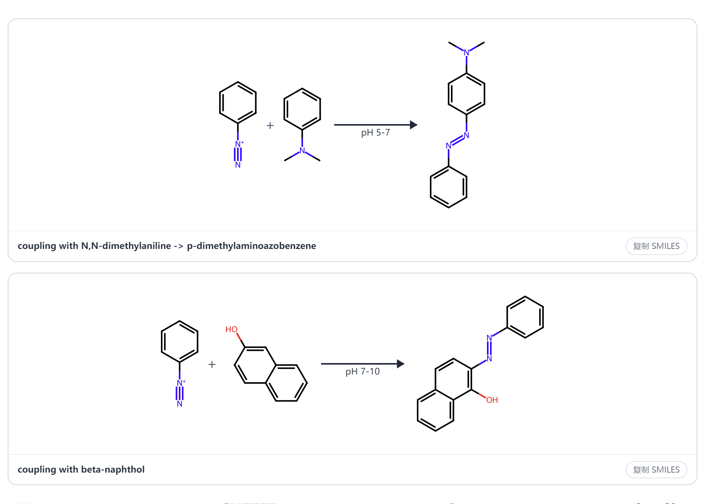

# v158 · 反应箭头位置（缺 reagents 时飞到顶部）

> 版本：**UI v158 / APP 1.0.48**
> 现象：偶联反应式里箭头跑到图的顶部，`pH 5-7` 却留在中间偏下（用户截图 2026-11-25 11:2x）

## 根因

v156 把箭头列改成了三行网格 `1fr auto 1fr`，但没有钉死每个子元素的行号，
依赖 DOM 顺序自动放置。模板里三样东西的顺序是：

```
[有才渲染] .chem-agents   ← reagents
           .chem-arrow-line
[有才渲染] .chem-cond-arrow  ← conditions
```

这条反应只有 `conditions:`、没有 `reagents:`，于是子元素只剩 [箭头线, 条件]：

- 箭头线被自动放进**第 1 行**（1fr）
- 条件被放进第 2 行（auto）
- 第 3 行空着

结果箭头线停在“第一行正中” = 图高 1/4 处 —— 就是用户看到的“箭头飞到上面”。

## 修复

1. 三样东西显式钉死行号，不再依赖顺序：

```css
.chem-agents    { grid-row: 1; align-self: end; }
.chem-arrow-line{ grid-row: 2; }
.chem-cond-arrow{ grid-row: 3; align-self: start; }
```

2. 有标签时给箭头列一个下限高度（`min-height: 120px`），短分子也不会把两行字挤到框外：
   模板里按 `above || below` 加 `has-labels` 类。
3. `.chem-canvas` 的上下内边距改成对称（原来 `10px 8px 2px`，导致整体视觉中心偏上 4px）。

## 实测（安装版，几何测量）

| 用例 | 结构中心 | 箭头线 | 条件与箭头间距 |
|---|---|---|---|
| 偶联（无 reagents，只有 conditions） | 163 / 163 / 163 | **163** | 2px |
| 萘酚偶联（同上） | 475 / 475 / 475 | **475** | 2px |

修复后：



## 测试

`test-ui` §4.5 新增 3 条（共 **62** 项）：
- 没有试剂时箭头线仍与三个结构中心同线（≤2px）
- 条件紧贴箭头下方（0–10px）
- 没有试剂时不渲染空 `.chem-agents`

`npm test` → API **84/84**、UI **62/62**；安装版 Electron **15/15**。

## 改动文件

- `public/style.css`：方向列网格钉行号、`has-labels` 下限高度、canvas 上下 padding 对称
- `public/chem.js`：模板按需加 `has-labels`
- `scripts/test-ui.mjs`：+3 条几何用例（顺带把探针里一个写错的测试 SMILES 修正为 `CN(C)c1ccc(/N=N/c2ccccc2)cc1`）
