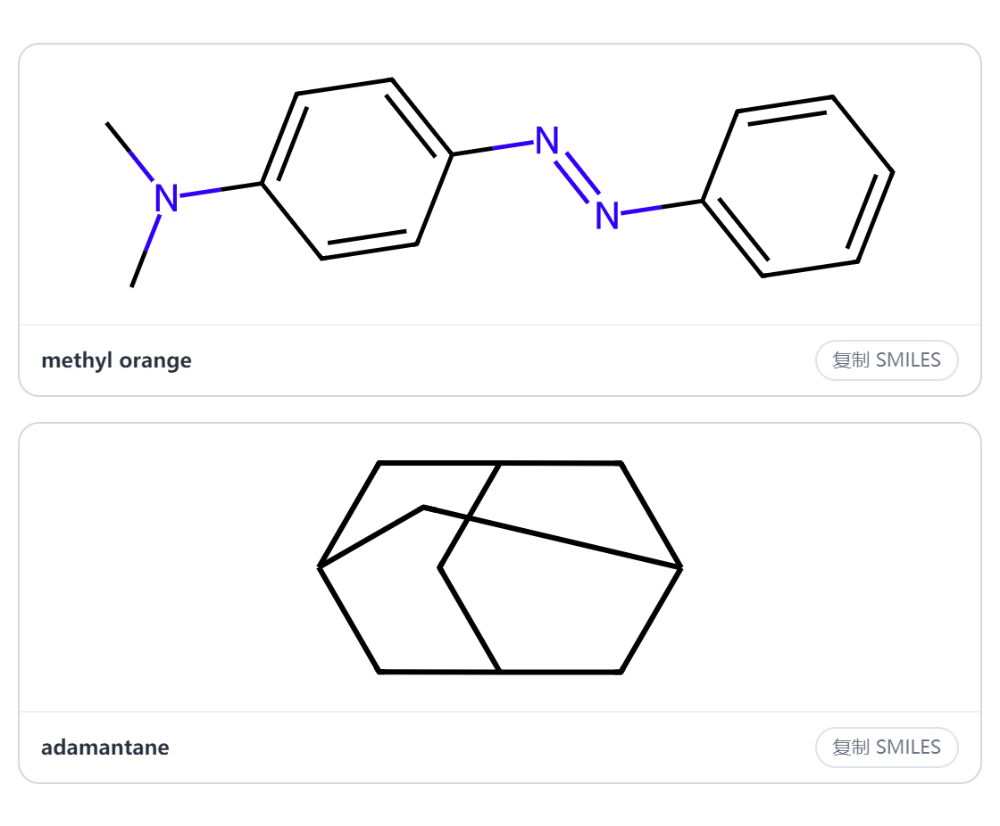

# v159 · 单分子朝向算法（空间利用率）

> 版本：**UI v160 / APP 1.0.50**（v159 先在真机试；v160 加上放大上限，一起交付）
> 需求：「单个化合物呈现的时候空间利用率大一点，比如甲基橙理想情况是氮氮双键水平」

## 一、原来的问题

`moleculeSvg` 里有两处反向逻辑：

```js
for (const rotate of [-angle, 90 - angle]) { ... }   // 横 / 竖两个候选
candidates.sort((a, b) => a.w - b.w)                  // ← 选“宽度更小”的
```

也就是说：**故意挑了竖着的那张**。甲基橙被竖着塞进卡片，两侧大片留白，卡片被撑得很高。

实测（RDKit 默认布局就是横的）：

| rotate | 包围盒 | 宽高比 |
|---|---|---|
| 0° | 368 × 97 | 3.79 |
| 90° | 97 × 368 | 0.26 |

## 二、算法

```
1. molblock → 原子 2D 坐标 → PCA 主轴角 a（分子长轴方向）
2. 候选角 = {-a（长轴水平）, 90-a（长轴垂直）, 0（RDKit 默认）}，去重
3. 每个候选按固定键长渲染（单分子 30 / 反应组分 18）→ 裁切出真实包围盒 (w,h)
4. 排序：
   a. 宽高比 w/h 更大者优先（越横越省纵向空间）
   b. 比值差 < 0.06 时，比“在可用框里能画多大” scale = min(可用宽/w, 高度上限/h, 1.5)
   c. 再打平取更宽的
5. 落地尺寸 = (w,h) × scale，等比，`max-width:100%` 防溢出
```

**为什么加 1.5 倍上限**：第一版直接“填满可用宽度”，结果金刚烷（5 个原子的笼状分子）被放大到
460×269、键长 120px，像糊在卡片上。加上 `UPSCALE_MAX = 1.5` 后：键长最多 45px，
既有存在感又不失真。这也是为什么先用 v159 在真机上截图对比、再改成 v160 一起交付。

## 三、效果（安装版实测）

| 分子 | 之前 | 现在 |
|---|---|---|
| 甲基橙 `CN(C)c1ccc(/N=N/c2ccccc2)cc1` | 竖排，宽 ~100px，卡片高 ~600px | **460 × 137，N=N 水平，卡片 198px** |
| 金刚烷 `C1C2CC3CC1CC(C2)C3` | 竖排 / 或过度放大 | 227 × 141（1.5 倍上限），卡片 203px |



同一套规则也作用于反应式的每个组分（键长 18、不做放大），所以反应行里的结构也统一是横的，
不会因为某个组分被默认为竖向而把整行撑高；这一点由 v158 的箭头中线逻辑兜底。

## 四、缓存

- key = `b<键长>:<可用宽度分桶>:<SMILES>`，宽度变化（换窗口、窄屏）会重新选朝向
- 上限 `MAX_MOL_CACHE = 200` 条，超出 LRU 淘汰

## 五、测试

`test-ui` §4.6 新增 8 条（共 **70** 项）：

- 甲基橙宽高比 ≥ 2.5（实测 3.37）、横向宽度 ≥ 400px、卡片高 ≤ 260px
- 金刚烷宽高比在 0.6–2.2 之间（不会被压成细长条）、高度 ≤ 420px
- 窄容器（240px）不溢出
- 同一分子在不同宽度下会重新选择（缓存分桶）

`npm test` → API **84/84**、UI **70/70**；安装版 Electron **15/15**。

## 六、改动文件

- `public/chem.js`：`molPoints` / `principalAngleDeg(pts)` / 候选角 + 打分排序 / `UPSCALE_MAX` / `fitMolecule(svg, item, availW, maxH)`
- `scripts/test-ui.mjs`：§4.6 八条布局用例
