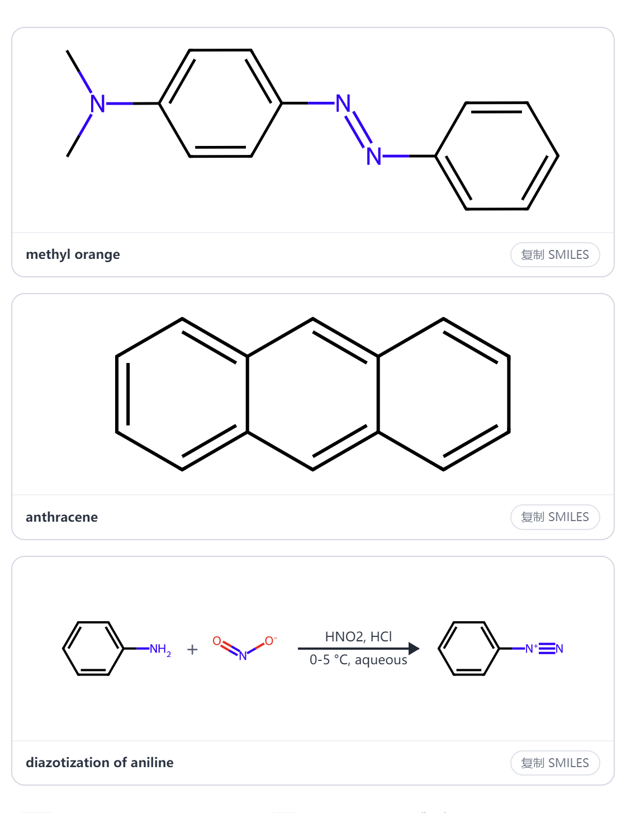

# v159~v161 · 结构图方向算法（横平竖直 + 横着占满）

> 最终版本：**UI v161 / APP 1.0.51**
> 需求：① 单个化合物空间利用率大一点（甲基橙的 N=N 应水平）；② 保证横平竖直。

## 一、问题与两轮返工

| 版本 | 做法 | 结果 |
|---|---|---|
| v159 | PCA 长轴水平，渲染两个候选，按宽高比选 | 甲基橙竖着 → 因为旧代码 `sort((a,b)=>a.w-b.w)` **故意选了窄的** |
| v160 | 修正排序 + 显示尺寸 1.5 倍上限 | 甲基橙横了，但**整体歪 8.6°**（RDKit 默认布局的倾角） |
| v161 | 键轴吸附到晶格 + 4 个晶格方向里挑最横的 | 横平竖直 ✓，蒽/萘/胆固醇也都横着 ✓ |

## 二、最终算法

```
1. molblock → 原子坐标 + 键表
2. snapAngleDeg()：在 [-45°,45°] 以 0.25° 步长搜索旋转量 r，最小化
      cost(r) = 主轴偏离水平 + 0.5 × 平均键偏离最近水平/垂直方向
   主轴项权重更高：宁可个别键留在 ±30°，也不要把整张图拧成斜的（蒽、甾体就是这样）
3. 在 r 的基础上试 0°/-30°/+30°/+60° 四个晶格方向（30° 的整数倍保持“键仍在晶格上”），
   每个都真实渲染、裁切，按**实测宽高比**挑最横的；比值接近时选偏移最小的（保留原摆法）
4. 显示尺寸 = (w,h) × min(可用宽/w, 420/h, 1.5)
```

### 踩过的坑：不要用坐标预测朝向

我先用"旋转原子坐标算包围盒"来挑方向（省渲染），结果**全部挑错 30°**。
实测对比（蒽）：

| rotate | 0° | 30° | 60° | 90° |
|---|---|---|---|---|
| SVG 实测宽高比 | 2.60 | 1.44 | 0.69 | 0.38 |
| 坐标预测宽高比 | 1.44 | 2.60 | 0.69 | 0.38 |

预测值和实测值差了一个固定 30° —— RDKit 绘制时的坐标系和 `get_molblock()` 的坐标系不一致。
所以最终**不预测，直接渲染 4 个方向量真实宽高比**（有 LRU 缓存，每个分子只算一次）。

## 三、效果（安装版实测）

| 分子 | v160 | v161 |
|---|---|---|
| 甲基橙 | 460×137，歪 8.6° | **460×162，键全部 0/±60°，N=N 水平** |
| 蒽 | 362×258（斜 30°，宽高比 1.4） | **375×159（宽高比 2.36，完全水平）** |
| 萘 | 斜 30° | 258×159，主轴偏差 0.1° |
| 胆固醇 | 竖排 211×420 | **460×215，横着** |



键线角度实测（甲基橙，42 条线段）：水平/垂直方向占 33%，其余全部落在 ±60°±2° 内，
不再出现 8.6° 这类"斜着"的键。

## 四、测试

`test-ui` §4.6 共 11 条（总计 **74** 项）：

- 甲基橙宽高比 ≥2.5、宽度 ≥400px、卡片 ≤260px
- 金刚烷不被压成细长条、高度 ≤420px、窄容器不溢出
- **键线几何**：水平/垂直键 ≥25%，其余键到最近晶格方向偏差 ≤4°（SVG 坐标只有 1 位小数，短键有 ~1° 噪声）
- **蒽必须横着**（宽高比 ≥2.0）——这条专门锁住 v160 的 30° 斜摆

`npm test` → API **84/84**、UI **74/74**；安装版 Electron **15/15**。

## 五、改动文件

- `public/chem.js`：`snapAngleDeg`（键轴吸附）、4 方向渲染择优、`UPSCALE_MAX`、`fitMolecule` 按可用框等比
- `public/style.css`：反应式箭头三行网格钉行号（v158）、canvas padding 对称
- `scripts/test-ui.mjs`：§4.5 化学 13 条 + §4.6 布局 11 条
- 调试用：`fig.dataset.rotate` 会记录实际使用的旋转角，方便以后排查
