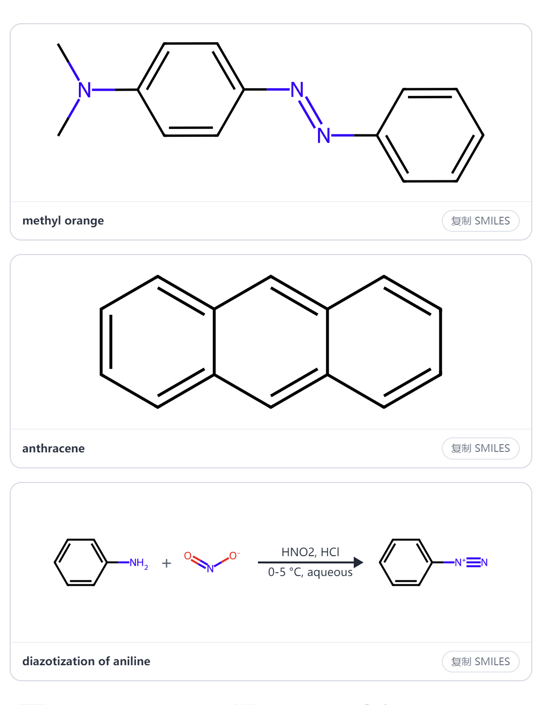

# v159~v162 · 结构图方向与尺寸（最终版）

> 最终版本：**UI v162 / APP 1.0.52**
> 需求演进：① 空间利用率高一点（甲基橙的 N=N 应水平）→ ② 横平竖直 → ③ **不要任何情况都优先全横，横向空间宝贵**

## 一、四轮调整与最终结论

| 版本 | 做法 | 结果 |
|---|---|---|
| v159 | PCA 长轴水平，两个候选按宽高比排序 | 甲基橙竖着 —— 旧代码 `sort((a,b)=>a.w-b.w)` **故意选了窄的** |
| v160 | 修正排序 + 放大 1.5 倍上限 | 横向了，但**整体歪 8.6°**（RDKit 默认倾角） |
| v161 | 键轴吸附 + 4 个晶格方向挑最横 | 横平竖直 ✓，但**所有分子都被拧成横条**（横向空间被吃满） |
| **v162** | **只纠正小倾角，方向交给 RDKit 原布局** | 甲基橙/蒽横得自然，紧凑分子不拉伸，竖长分子保持竖 ✓ |

## 二、最终算法（12 行）

```
1. molblock → 原子坐标 + 键表
2. snapAngleDeg()：在 [-45°,45°] 以 0.25° 步长搜索旋转量 r，最小化
      cost(r) = 主轴偏离水平 + 0.5 × 平均键偏离最近水平/垂直方向
3. 只纠正小倾角：|r| ≤ 20° 才应用，否则 r = 0
      —— 超过 20° 说明本来就是合法的晶格摆法（30°/90°/150°），保持原样
4. 渲染一次，裁切出包围盒 (w,h)
5. 显示尺寸 = (w,h) × min(可用宽/w, 高度上限/h, 1.5)
```

**为什么不做方向比较**：
- 横向空间宝贵 —— 为了"更宽"把竖长分子拧过来，等于用一个 460px 的横条换掉本来合适的竖排；
- 而且用坐标预测方向会踩坑：RDKit 绘制坐标系与 `get_molblock()` 差一个固定 30°（实测蒽：
  SVG 宽高比 rotate 0° 为 2.60、预测为 1.44），预测必然挑错。

## 三、效果（安装版实测）

| 分子 | 结果 |
|---|---|
| 甲基橙 | 460×162，rotate 8.5°（把 8.6° 的倾角纠正掉），N=N 严格水平，键全部 0/±60° |
| 蒽 | 375×159，rotate 0°，三个环排成一行，水平 |
| 萘 | 258×159，主轴偏差 0.1° |
| 苯 | 159×141，紧凑不被拉伸 |
| 金刚烷 | 227×141，1.5 倍封顶 |
| 乙醇 | 168×69，自然比例 |
| 偶联反应 | 每个组分键长 18、各自吸附，箭头/条件在中线（v158 规则） |



## 四、测试

`test-ui` §4.6 共 12 条（总计 **75** 项）：

- 甲基橙宽高比 ≥2.5、宽 ≥400px、卡片 ≤260px
- 金刚烷不被压成细长条、高度 ≤420px、窄容器不溢出
- **键线几何**：水平/垂直键 ≥25%，其余键到最近晶格方向偏差 ≤4°
- **蒽必须横着**（宽高比 ≥2.0）
- **不为变宽而旋转**：所有单分子卡片的 `fig.dataset.rotate` 必须 ≤20°（只允许小倾角纠正）

`npm test` → API **84/84**、UI **75/75**；安装版 Electron **15/15**。

## 五、改动文件

- `public/chem.js`：`snapAngleDeg`（键轴吸附）、`SNAP_MAX_DEG=20`、`UPSCALE_MAX=1.5`、单次渲染
- `public/style.css`：反应箭头三行网格（v158）、canvas padding 对称、`.has-labels` 下限高度
- `scripts/test-ui.mjs`：§4.5 化学 13 条 + §4.6 布局 12 条
- 调试辅助：`fig.dataset.rotate` 记录实际旋转角
