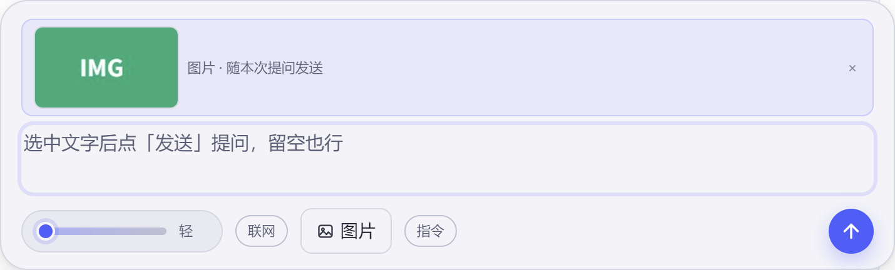

# v166 · 「图片」按钮：选一张图随这次提问发送

> 版本：**UI v166 / APP 1.0.56**

## 一、新增

输入框工具条多了一个 **「图片」** 按钮（在「联网」和「指令」之间，带小图标）。
点它 → 选一张本地图片 → 挂到**本次提问**上（不是导入成文档）：

```
[缩略图 240×96] 图片 · 随本次提问发送        ×
```

- 和「粘贴图片」走同一条处理：长边 ≤1280、JPEG 0.85、PNG 透明底垫白
- 只贴图/只选图不打字 → 自动问「请解释这张图里的内容」
- 选完焦点回输入框，可以直接打字发送
- 再点一次可以换图；chip 上的 × 取消
- 文件选择框的 value 会重置，连续选同一张图也有效

顺带让**拖放**也分两条路：拖到输入框 = 配图；拖到别处 = 导入文档。

## 二、排版调整

老样式里 `.shot-thumb` 是 `width:100%`，整张图会被拉满输入框宽度、占掉一大块高度。
改成按比例缩到 **240×96** 以内、`object-fit: contain`，说明文字跟在缩略图右边。



## 三、测试

`test-ui` 新增 4 条（共 **94** 项）：

- 点「图片」→ 文件选择框 → 挂到输入框（不是导入）
- 选图后文档数不变
- 选图后焦点回输入框
- 选图后 file input 已重置

`npm test` → API 91/91、UI 94/94；安装版 Electron 15/15。

## 四、改动文件

- `public/index.html`：`#btn-image` 按钮 + 隐藏的 `#image-input[type=file][accept=image/*]`
- `public/app.js`：按钮绑定、change 处理、拖放分流
- `public/style.css`：按钮样式、缩略图尺寸
