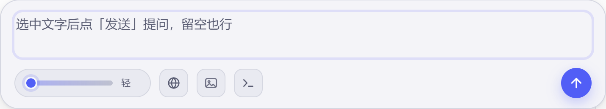

# v167 · 输入框工具条：三个统一尺寸的纯图标按钮

> 版本：**UI v167 / APP 1.0.57**

## 一、改动

「联网 / 图片 / 指令」原来是有文字的胶囊按钮（字宽不一、风格和发送键也不统一）。
现在统一成 **34×34 的圆角图标按钮**，只留图形：

| 按钮 | 图标 | 说明 |
|---|---|---|
| 联网 | 地球（经线 + 赤道） | 开启时保留高亮态（accent 描边 + 淡底） |
| 图片 | 相片（方框 + 山 + 太阳点） | 点开选图，随本次提问发送 |
| 指令 | 终端提示符 `>_` | 开启时同样高亮 |

- 都带 `title` 悬停提示和 `aria-label`（纯图标不能丢可访问名）
- 图标统一 17×17，线宽 1.9，`currentColor`，跟随主题色
- 窄屏（≤720px）也不再挤：本来就是图标，不用再藏文字
- 图片 chip 的缩略图仍按上版规则（≤240×96），与图标按钮同一视觉体系

## 二、测试

`test-ui` 里所有对这三个按钮的点击用例不变（都是按 id 点），94/94 通过；
安装版 Electron 15/15（含「点联网后焦点仍在输入框」）。
`npm test` → API 91/91、UI 94/94。

## 三、改动文件

- `public/index.html`：三个按钮换成 SVG 图标，加 `aria-label`，去掉文字
- `public/style.css`：`.composer-foot #btn-web/#btn-image/#btn-instr` 统一 34×34 图标按钮样式与高亮态
