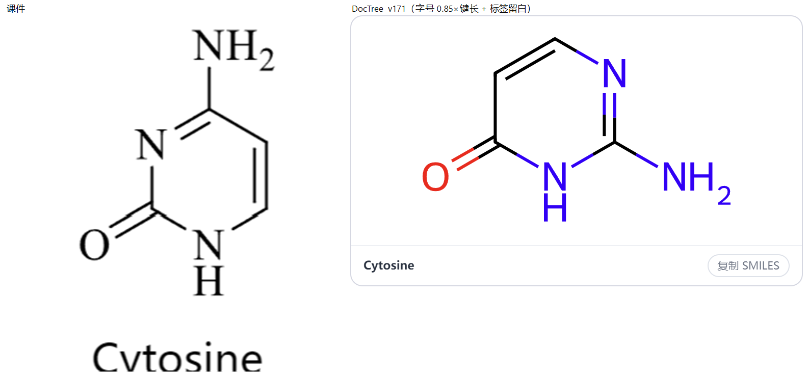

# v171 · 杂原子符号比例与相连键长（对齐课件）

> 版本：**UI v171 / APP 1.0.61**
> 需求：照着课件（吡啶/胞嘧啶/尿嘧啶）的效果，调杂环里杂原子符号的相对大小，以及连到它们的键的长度。

## 一、对比出来的差异

把课件截图和 DocTree 的渲染缩放到**同一个环宽**后对比（`docs/chem-label-compare-v171.png`）：

| | 课件 | DocTree（改前） |
|---|---|---|
| 杂原子符号（N/O/NH/NH₂）相对环的大小 | 大，约环高的 1/5 | 小，约 1/8 |
| 连到杂原子的键 | 很短，几乎只露一小段 | 长，符号被推得很远 |
| 键和符号的关系 | 键贴到符号边缘就停 | 键离符号还有一段 |

原因：RDKit 默认 `baseFontSize ≈ 0.6×键长`，字号偏小；而**键的可见长度 = 键长 − 符号半宽 − 留白**，
字号小 → 符号窄 → 键显得长。所以「把符号调大」和「把键调短」是同一件事。

## 二、改法

`public/chem.js` 的 `moleculeSvg()` 里给 RDKit 传：

```js
fixedBondLength: bond,                  // 键长基准（单分子 30 / 反应组分 18）
fixedFontSize: Math.round(bond * 0.85), // 符号 ≈ 0.85×键长（原来是 ~0.6）
additionalAtomLabelPadding: 0.08        // 再留一点内边距，键会提前收住，不会画进字母里
```

- 0.9 试过：符号更大，但在 `C=O` 这类双键上，第二条线会顶进 `O` 的字形里，所以退到 0.85
- `additionalAtomLabelPadding` 让键在符号边缘前就停住，避免"线穿过字母"，同时把可见键再缩短一点
- 反应式里的组分（键长 18）同样生效，字号 = 15，比例一致

## 三、效果

同一环宽下（左课件 / 右 DocTree v171）：



实测（胞嘧啶，安装版）：`labelH = 19.7`（改前 13）、`maxBond = 45`、`molH = 121`
→ 符号占分子高度 **16.3%**（改前 11.8%），与课件接近。

## 四、测试

`npm test` → API 91/91、UI 107/107（化学段的比例/裁切/朝向用例全部通过；
更大的符号没有导致键线越界或卡片裁剪）。

安装版已同步 1.0.61，启动日志 `[DocTree] UI v171`。

## 五、附：为什么不换衬线字体（2026-11-26 结论）

课件是衬线（Times 风格），看起来更"教科书"。试过一版原型后决定**不换**：

1. RDKit 最小版把原子标签**烘成了矢量路径**（`path.atom-N`），JS 胶水没有 `fontFamily/fontFile`，
   wasm 里也没有字体资源 —— 换字体等于把标签层整个换成自绘 `<text>`。
2. 自绘就要自己重建标签模型：元素 + **隐式氢**（molblock 的 hcount 是 0，氢按价态推）+ 电荷 + 同位素 + 上下标。
   原型里立刻出现 `NH`→`N`、`NH₂` 掉 H 的问题，这正是主要风险。
3. 衬线字形比 RDKit 的无衬线细，和同样粗细的键并置会"标签发飘"；课件其实是"字粗 + 键细"的组合。

结论：保留**粗键 + 无衬线**。若将来一定要课件观感，正确路径是换渲染器（如 `smiles-drawer` 这类用真 `<text>` 的库），
而不是给 RDKit 打字体补丁 —— 但那需要重做反应式/箭头/条件/朝向/裁剪这一整套验证。